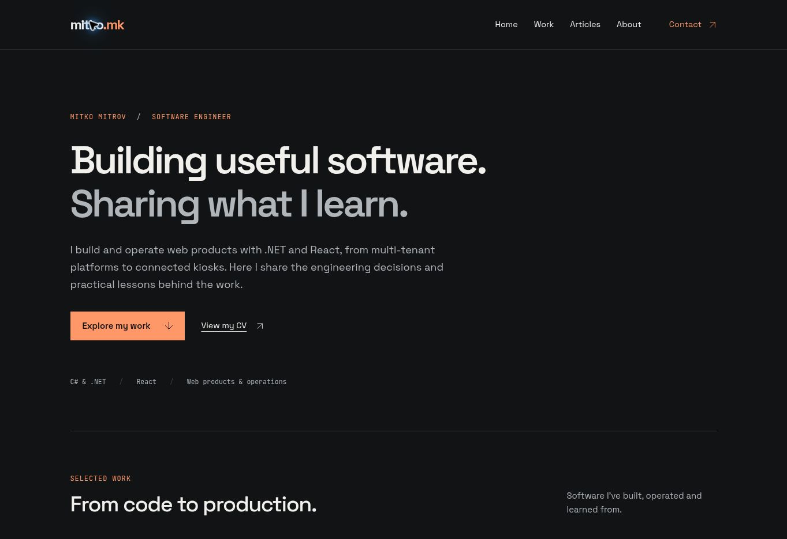

# WEB-02 — Minimal light portfolio

**Released and verified over HTTPS.** See [release evidence](WEB-02-release.md). The implementation notes below describe the reviewed pre-release snapshot.

[WEB-02](https://trello.com/c/ZsBFpdax) · [Draft PR #3](https://github.com/MitkoMitrov/mitkomitrov.github.io/pull/3) · [Astro foundation / draft PR #2](https://github.com/MitkoMitrov/mitkomitrov.github.io/pull/2)

## Result

A short identity block leads with Mitko's name, .NET / React role and one sentence about his work. Articles appears immediately below it, followed by a dated experience timeline, three concise project summaries and contact. The primary navigation is **Articles / Experience / Projects**; the name/logo returns home. Contact remains in the sticky header and footer. The brand, light palette, rounded navigation and portrait composition follow the owner's [visual reference](https://aitortita.com/), adapted to the requested focus on writing and work history.

There are no CV buttons, oversized marketing slogans, animated elements, technology walls or empty destination pages. The full intro contains fewer than 40 words. Recognizing the owner within 10–20 seconds is a design goal, not a measured usability result. At desktop width all three article links are visible before scrolling; the timeline is the next main section. On narrow screens the timeline stacks and article dates move above the titles.

The current owner direction supersedes the ticket's original homepage ordering, dark visual iteration and Home / Work / Articles / About menu. No unrelated tickets were changed. `#about` resolves to the brief introduction, `#skills` to its summary, and the existing `#experience`, `#work`, `#contact` and `/CV/CV.html` destinations remain valid. The CV route is retained as an existing URL without advertising a stale CV in the new homepage.

## Template reuse

The [official Astro Portfolio Starter](https://github.com/withastro/astro/tree/main/examples/portfolio) supplies an adapted `Hero.astro`, light palette and navigation styles. Its MIT notice is preserved in `third_party/astro-portfolio.LICENSE`; source blob IDs and adaptation details are in `third_party/README.md`.

Only reusable layout pieces were imported. Mitko's text comes from his supplied CV and approved project context. The portrait already existed at `/assets/img/perfil2.jpg`. The reference site's personal copy, photographs and project images were not imported. The background is CSS; no new image generation, external fonts, runtime framework or dependency changes are needed. The original navigation's JavaScript menu/theme system was not imported; all three section links stay visible without JavaScript.

## Content provenance

Source: the owner's **CV — Mitko Mitrov.pdf**, pages 2–4, supplied in this conversation. The file is not committed or published. Figures below are CV-reported facts, not independently audited analytics.

| Content | Source and treatment |
| --- | --- |
| Meta5Team timeline | Mar 2022–present; 50–100 legacy endpoints, cashier software with 5,000–10,000 daily users, MAUI on 50+ kiosks (page 2) |
| Freelance timeline | Sep 2021–present; Canadian sports booking platform, around 1,000 bookings/month (page 3) |
| SPD Computing timeline | Oct 2019–May 2021; banking migration, reporting and branch printing (page 3) |
| Imenologija.mk | In development, 2026–present; names encyclopedia with Next.js / Payload / PostgreSQL (page 3) |
| WhoWinSelections.com | Past project, Feb–Nov 2024; 100+ sources, about 1,000 daily users during operation (page 4) |
| AI Daily Stock Reports | Past project, Sep 2024–Feb 2025; reporting pipeline, about 30% lower AI operating cost (page 4) |

Professional kiosk work is described in the timeline rather than duplicated as a project card. No unverified product URL is advertised as live. Full case studies and verified live-product links remain WEB-13. The existing HTML CV is byte-preserved and predates the supplied PDF; a full CV content sync is a separate update.

Three real LinkedIn pages were verified earlier on 16 November 2026 and retain their direct URLs:

| Published | Article |
| --- | --- |
| 1 Oct 2026 | [When to Use Redis—and When Not To](https://www.linkedin.com/pulse/when-use-redisand-mitko-mitrov-09cxf) |
| 10 Sep 2026 | [Redis in Practice: Cache-Aside, TTL, and Eviction](https://www.linkedin.com/pulse/redis-practice-cache-aside-ttl-eviction-mitko-mitrov-ilqlf) |
| 1 Sep 2026 | [Why Redis? What problem does it actually solve?](https://www.linkedin.com/pulse/why-redis-what-problem-does-actually-solve-mitko-mitrov-zaepf) |

These entries use short original summaries, newest first, and identify LinkedIn as the reading destination. No full articles, fixture posts or Sanity drafts are included. Local article listing/body pages remain WEB-04.

## Verification

Node 24.22.1 / npm 11.9.0; existing locked dependencies:

```sh
npm run check
git diff --check
```

**All 8 checks pass.** Astro builds one complete static homepage; the verifier accepts **20 files** including generated CSS and byte-preserved assets/CV/CNAME. Checks cover the new hierarchy, brief intro, no CV actions, exact timeline dates, CV-backed project states, real article URLs and date order, first-party destinations, semantics, contrast, public staging and the guarded Pages workflow.

The implementation adds no browser scripts, hydration, content fetching, Google Fonts request, form backend or CMS connection. The public allowlist still rejects unexpected routes, JavaScript chunks and source files.

| Requirement | Evidence | Result |
| --- | --- | --- |
| Brief identity, Articles as primary focus | Name / role / short bio; Articles first after intro; all three links visible on checked desktop viewport | Pass locally; reading time not user-tested |
| Experience timeline | Three CV-derived entries with month/year dates, role and one concise contribution summary | Pass |
| Projects | Three compact, CV-derived entries with development/past status labels | Pass |
| No CV buttons | Static test and browser DOM report zero homepage links to `/CV/CV.html` | Pass |
| Light reference-based appearance | White / purple template palette, rounded menu, own portrait, compact spacing | Pass locally; owner review pending |
| Desktop and narrow reflow | 1363px CSS desktop and 340px CSS at 400% browser zoom; no horizontal overflow; timeline becomes one 297px column | Pass for tested widths; physical phone not tested |
| Keyboard and contact | Tab reveals skip link; Enter focuses main; visible focus outlines; section links and email targets work | Pass locally; no screen-reader session or email send claimed |
| Contrast | Foreground, muted and purple accent text each exceed 4.5:1 against white; dark outline for keyboard focus | Pass |
| URL / deployment boundary | Historical root HTML, CV/assets/CNAME, package versions and workflow unchanged | Pass locally; live release unverified |

Manual browser QA used the built `dist/` through the managed static preview, rather than the previously incompatible managed Astro dev launcher. The copied preview directory is temporary and is not part of the repository. Narrow screenshots are browser-zoom reflow evidence, not physical-device tests.

[Full page](images/WEB-02-full.jpg) · [Desktop viewport](images/WEB-02-preview.jpg) · [Narrow header](images/WEB-02-narrow.jpg)



## Branch and release

- Repository default: `master`, last verified at `2fce845161e70b4f67472767b96c2be8bd0bc94e`; no repository `AGENTS.md` found.
- Foundation: `web-03/astro-ssg` at `d5f0d6cfa8d6c3dab676787f1067c3b842959c63` (draft PR #2).
- This work updates `web-02/homepage-navigation` and the existing draft PR #3. PRs #1/#2 remain untouched.
- Review/merge WEB-03 first; then retarget WEB-02 to `master` and require CI before release. The existing workflow's master-only PR filter means this stacked PR has no GitHub Actions run yet; local checks are not represented as CI success.
- Nothing is merged or deployed. No DNS, authentication, Pages configuration, billing or production data changes.
- WEB-02 remains open for visual/content review and eventual deployed checks. No owner PC session is needed for this implementation. WEB-01's outstanding editor checks remain independent.
