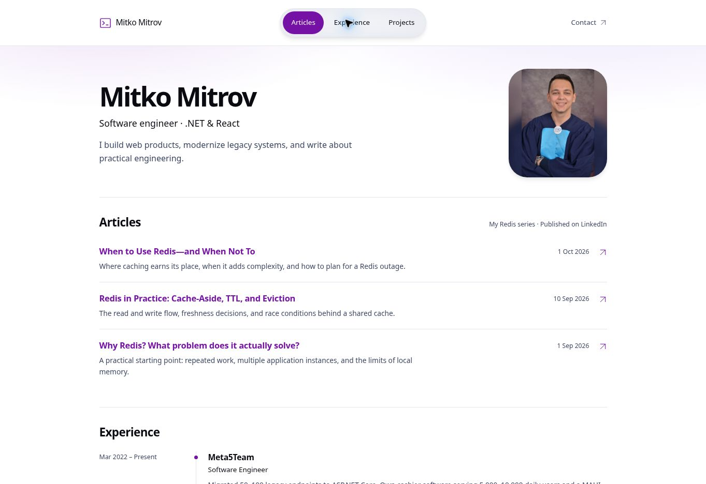

# WEB-02 / WEB-03 — Released portfolio

Verified 16 November 2026 after owner approval to merge and deploy.

- **Live site:** https://mitko.mk/
- Astro foundation PR #2 merged at `362ee59558a44847c881c6060ea2f89fbd308852`.
- Homepage PR #3 merged at `886245d8905a1932ec465a087014987a23cba71e` after [real GitHub CI](https://github.com/MitkoMitrov/mitkomitrov.github.io/actions/runs/43839964301) passed all eight checks.
- [Production build/upload/deployment](https://github.com/MitkoMitrov/mitkomitrov.github.io/actions/runs/43840171054) succeeded.
- In the authenticated repository settings, changed Pages Source from **Deploy from a branch** to **GitHub Actions**, then enabled **Enforce HTTPS**. Both settings persisted after reload. The custom domain remains `mitko.mk`; DNS verification passed. No domain removal, DNS changes, new credentials or permission expansion.

## Live verification

| Check | Result |
| --- | --- |
| `https://mitko.mk/` | HTTP 200; valid HTTPS; HTML byte-identical to the tested static build |
| `http://mitko.mk/` | Redirected to `https://mitko.mk/`, final HTTP 200 |
| Canonical URL | `https://mitko.mk/` |
| Experience navigation | Reached the live dated timeline at `/#experience` |
| `/CV/CV.html` | HTTP 200 over HTTPS; existing route preserved and opened in browser |
| `/assets/img/perfil2.jpg` | HTTP 200; portrait rendered, natural width 1079px |
| `/_astro/index.D0OfXBC6.css` | HTTP 200 over HTTPS |
| Homepage SHA-256 | `287576517c97941e211dca2b31595565329539f999c99d7406ffa2804d595c51` |

The old branch-based Jekyll job failed before the Pages source switch; the Astro deployment succeeded independently. Source is now explicitly GitHub Actions. A failed Astro build is prevented from uploading/deploying by the tested job dependencies. Production was not deliberately broken for a failure-injection test.

No product code changed during this release verification. The follow-up documentation commit records this evidence and exercises the selected Actions source. WEB-01 remains unmerged, with its editor/paste/private-draft and CMS publishing checks separate from the deployed static portfolio. No further owner setup is required for this release.

